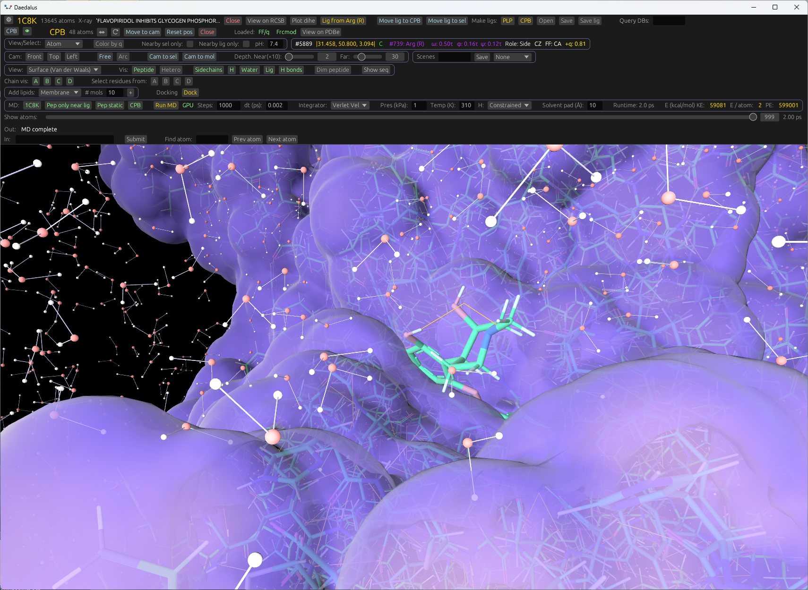
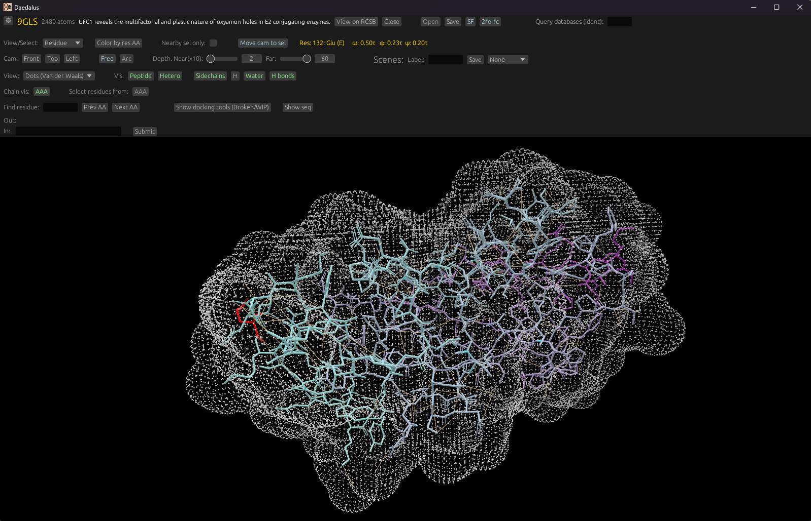
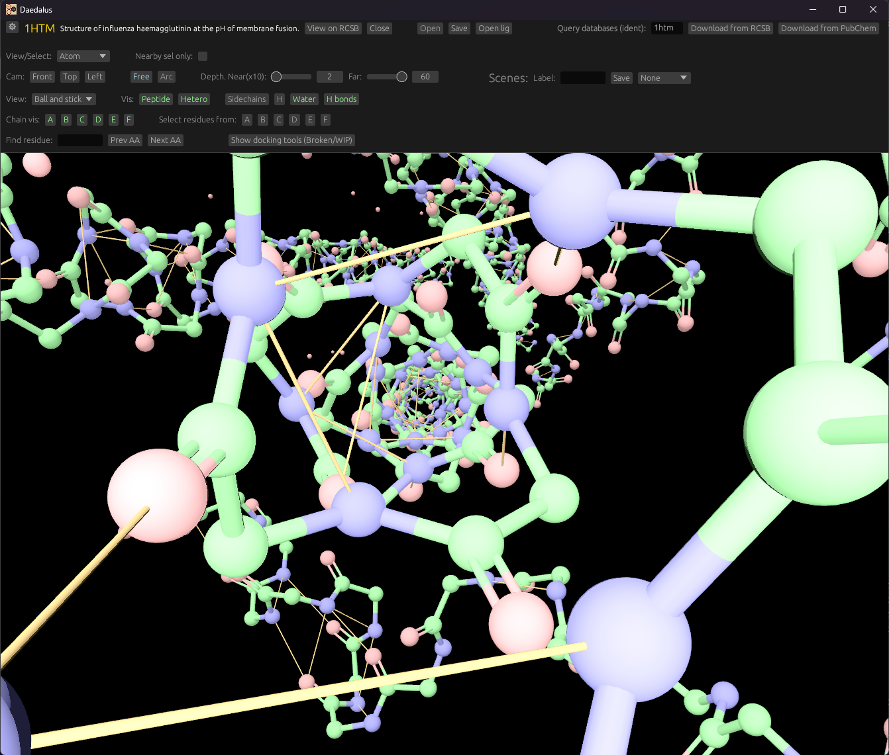
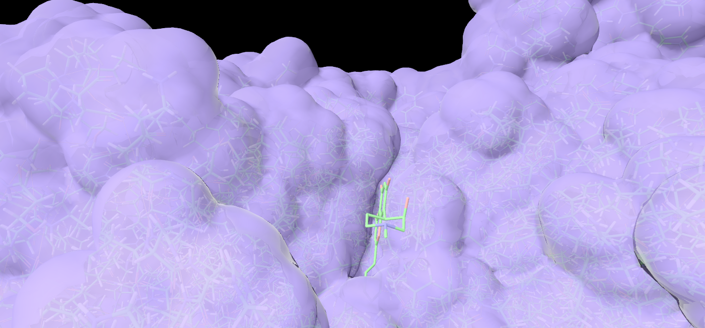
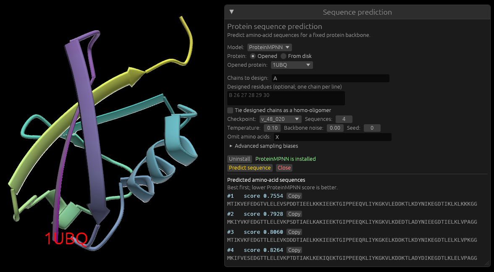
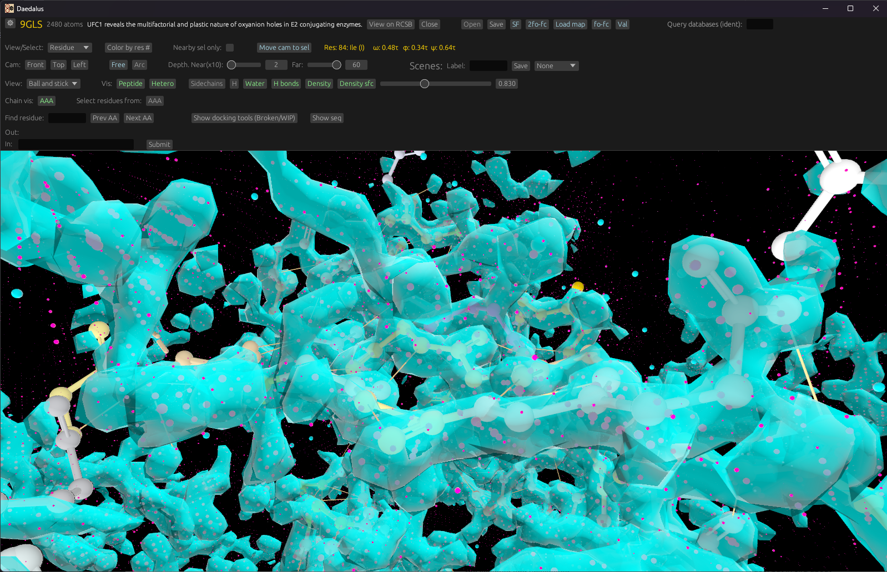
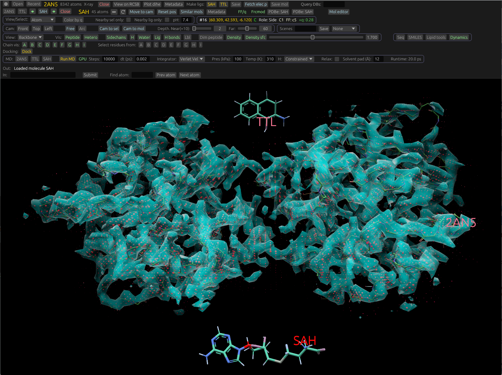

# Molchanica

[](https://www.athanorlab.com/docs)

[Home page](https://www.athanorlab.com/molchanica)
[Documentation](https://www.athanorlab.com/docs)

[Molchanica](https://www.athanorlab.com/molchanica) is molecule editing, visualization, and dynamics tool with a focus
on a smooth user experience. It combines functionality found
in [PyMol](https://www.pymol.org/), [Chimera](https://www.cgl.ucsf.edu/chimera/), [Coot](https://www2.mrc-lmb.cam.ac.uk/personal/pemsley/coot/), [VMD](https://www.ks.uiuc.edu/Research/vmd/), [GROMACS](https://www.gromacs.org/),
and [Avogadro](https://avogadro.cc/), and operates with the focus on visualizing molecules over both time and space. Any
molecule you open or build can move using molecular dynamics. We are actively adding work-flow specific functionality;
for example, molecular docking, and tools for working with LNPs.

Molchanica includes Computer Aided Drug Design (CADD) tools. For example, molecule screening and generation based on
pharmacophores, machine-learning from empirical binding data and more. It automatically estimates ADME and toxicity
parameters.

We hope that Molchanica is intuitive enough that formal documentation isn't required; installing, running, opening, and
viewing molecules should be easy for someone to figure out by downloading, launching, and clicking around the GUI. This
documentation is a supplement that experimental process: It describes each feature. It may highlight features you didn't
know existed, clarify how to use a given feature, and show assumptions and implementations used.

For advanced topics like molecular docking, it provides instructions for achieving the best results. Use the menu on the
left to navigate these documentation pages.

This README is a summary. For details, see [the documentation](https://www.athanorlab.com/docs).

## Installation

### Windows and Linux

[Download, unzip, and run](https://github.com/David-OConnor/molchanica/releases).

Setup scripts are included; these are optional. (The application can be launched directly), but are
useful for setting up shortcuts in your OS.

- On Linux distros that use Gnome (e.g. Ubuntu), run `setup_molchanica.sh`, included in the zip, to create a Desktop
  GUI entry. (Do not run this with `sudo`.)
- On Windows, run `setup_molchanica.ps1` to move the program to `~/AppData/Local/Programs/Molchanica`, and create a start menu shortcut. The first time you run the program, you may get the message
  *"  Microsoft Defender prevented an unrecognized app from starting"*. To bypass this, click *More
  info*, then *Run
  Anyway*. A similar obstacle may be encountered on Windows: If it refuses to launch, with an error about "Smart App Control", you may disable "Smart App Control" in
  *Windows Settings*.



### Mac, and linux distros we don't provide a binary for

Compile from source by [downloading and installing Rust](https://www.rust-lang.org/tools/install), then running
`cargo build --release` from a CLI
in the project directory. See notes in the
*compiling* section below about setting up Amber parameter files,
and either installing the CUDA toolkit, or disabling CUDA.

### Installing and using integrated third-party tools

Supports, and manages the installation of third-party tool. E.g. GROMACS, ORCA,
Gemmi, and ML-based protein design tools. See [the documentation](https://www.athanorlab.com/docs/third_party_tools.html)
for details.

### Datasets

Molchanica can read a locally downloaded [PDBbind](https://www.pdbbind-plus.org.cn/) release:
measured binding affinities, plus each complex's protein, pocket, and ligand files. Unpack one
into `datasets/pdbbind` in Molchanica's own folder, or set `MOLCHANICA_PDBBIND_ROOT`. Nothing
downloads it for you — PDBbind+ is distributed under registration, free for academic use, with
commercial use requiring a subscription.

### Protein design

- **Backbone design** using RFDiffusion3
- **Structure prediction** using OpenDDE, Boltz-2, Chai-1, and EsmFold2
- **Sequence prediction** using ProteinMPNN and LigandMPNN

## Functionality

### Publication figures

Open **Publication figure** beside the view controls. Set exact pixel dimensions, PNG print
resolution (DPI), background color or transparency, and 2×/3× supersampling. **Use view aspect**
matches the camera's current aspect ratio; otherwise the preview shows the new framing. The
vertical field of view stays fixed. **Render preview** freezes the current geometry and camera
and renders the full export resolution on a worker thread. **Save PNG** writes those exact pixels,
including alpha and DPI metadata. Camera/window changes after rendering do not alter the saved
figure; render again to capture them. The checkerboard in the preview is not exported.

Figures include visible entity labels, with adjustable color and scale. Under **Distance
measurements**, select an atom, capture the start, select another atom, and add the distance.
Dashed lines and distances in Å are rendered with the figure. Measurements capture fixed world
coordinates; recapture them after moving molecules. Export reports an error if a measurement
endpoint falls outside the figure, rather than silently omitting it.

The export renderer uses smooth atom/bond meshes (Standard or High detail) and studio lighting, highlights,
screen-space contact shading, and optional depth outlines. Paper and Presentation presets, plus
named styles saved in `figure_styles.json` in the preferences folder, keep figure panels
consistent. Styles contain output and appearance settings; scene representations and camera
positions remain controlled by the main view and its camera snapshots. Label and outline sizes
scale with figure height, independently of window size or desktop DPI.

This is an offscreen raster renderer, not a ray tracer. Contact shading and outlines use opaque
geometry's depth; transparent surfaces use back-to-front entity sorting, which can be imperfect
for intersecting surfaces. Viewport fog, selection highlighting, and manipulation gizmos are
excluded. Gaussian volumes currently require switching to a mesh representation before export.
Exports support 64–8192 pixels per side, up to 32 million supersampled pixels, and are also
bounded by the GPU's texture limit. CUDA is not required.

### Other features

- View the 3D structure of proteins and small molecules
- Molecular dynamics, using Amber force fields, and the OPC water model
- Visualize ligand docking
- Edit small molecules in 3D with integrated dynamics
- Visualize electron density from crystallography and Cryo-Em data
- Run [GROMACS](https://www.gromacs.org/) MD, and view trajectories using the same GUI as our native MD.
- Run [ORCA](https://www.faccts.de/orca/) quantum chemistry procedures on molecules (if ORCA is installed).
- Run [OpenDDE](https://github.com/aurekaresearch/OpenDDE) structure prediction (Proteins, ligands, nucleic acids, ions, complexes)
- Run [Boltz-2](https://github.com/jwohlwend/boltz) co-folding, including binding-affinity prediction for a ligand in the folded complex
- Design sequences for a backbone with [LigandMPNN](https://github.com/dauparas/LigandMPNN) and
  [ProteinMPNN](https://github.com/dauparas/ProteinMPNN), conditioned on ligands and nucleic acids where present
- Scan every point mutation at every position for stability (ΔΔG), in a single pass, natively — no Python needed at run time
- Antibody workflows: CDR selection, paratope contacts, and developability triage
- Read a local [PDBbind](https://www.pdbbind-plus.org.cn/) release: look up a complex's measured binding affinity and open its protein, pocket, and ligand files
- Assess pharmacokinetics, screen small molecules for binding to pockets, pharmacophore features, molecule alignment,
  and more.
- Screen molecules based on binding affinity and desired properties
- Pharmacophore based modeling and screening

## Molecule types supported for viewing and dynamics

- Proteins
- Small organic molecules (e.g. ligands)
- DNA and RNA; double and single stranded
- Lipids

## Getting started

Launch the program. Either open a molecule using the "Open" or "Open Lig" buttons, drag the file into the program
window,
enter a protein identifier in the *Query databases* field, or click *I'm feeling
lucky*, to load a recently-uploaded
protein
from the [RCSB PDB](https://www.rcsb.org/).

**Most UI items provide tooltip descriptions, when you hover the mouse over them.**

## Goals

- Fast
- Easy-to-use
- Practical workflow
- Updates responsive to user feedback

## File formats

- **Proteins**: mmCIF (aka PDBx)
- **Small molecules**: SDF, Mol2, GRO, XYZ, and PDBQT
- **Electron density**: 2fo-fc mmCIF, Map, and MTZ
- **Force field parameters**: dat, lib, frcmod, prmtop (Amber), and top (GROMACS)
- **MD**: GRO, MDP, DCD, TRR, XTC

## Third-party tool integrations

Molchanica integrates with a number of third-party tools, acting on the molecules Molchanica has open,
or creating them. See [the docs page for details, and a full list of tools](https://www.athanorlab.com/docs/third_party_tools.html). These can be accessed directly from the computer if you have them installed,
or installed within the application's UI.

## Example tools supported:

- OpenDDE
- GROMACS
- ORCA
- Boltz-2
- MPNN (Protein, ligand etc)

(todo: Expand:)

## A note on internet connectivity

This application can run smoothly without internet connectivity. If you do have internet, it has some API integrations
which may help. For example, loading molecules automatically from PubChem, drugbank, and RCSB PDB. It can also
download associated ligands for a protein, automatically download molecule-specific force-field parameters, and
other party tricks.


## Parallel computing

If an Nvidia GPU of at least RTX 3 series is available, molecular dynamics, docking, and electron density calculations
will be performed using the GPU (via CUDA kernels). If not, the CPU will be used, leveraging thread pools
and SIMD instructions. It uses all cores available, and either 512-bit, or 256-bit, SIMD instructions, depending
on CPU capability.

GPU functionality requires Nvidia driver version 580 or higher.

The standard Windows and Linux downloads are built with CUDA support, but do not require it: CUDA's
libraries are looked up when the program starts rather than being linked into the executable. On a
machine with no Nvidia GPU, no driver, or a driver too old for the CUDA version we build against,
the program starts normally and reports `Cpu` as its computing device. The separate `nocuda`
downloads are smaller, and are otherwise equivalent on such machines.

## Molecular dynamics

This application fully integrates classical molecular dynamics setup and playback into the GUI.
For details, see [the documentation](https://www.athanorlab.com/docs/md.html).

It supports running MD directly on the following molecule types, without loading any other data:

- Proteins/amino acids
- Small organic molecules
- DNA and RNA
- Lipids
- Carbohydrates (WIP)

Overview of MD components:

- [Amber parameters](https://ambermd.org/AmberModels.php)
- Velocity Verlet integrator
- [CSVR](https://arxiv.org/pdf/0803.4060) or Langevin Middle thermostats
- Explicit OPC water model
- SPME Coulomb forces
- AM1-BCC partial charges (MBIS if you have ORCA installed)

We use the [Dynamics rust library](https://github.com/david-oconnor/dynamics) for the implementation. You may also wish
to reference that library's readme.

## Editing molecules

We provide an editor for small organic molecules. This is fully-3D, and has integrated dynamics, which can be run
continuously
while you edit. It ensures the molecules you create are realistic, and take the appropriate shape.

## The camera

The camera is set up with 6 degrees of freedom, using either keyboard + mouse, or mouse only. This makes
it easy to get any view of the system you want.

There are two camera control schemes, selectable using buttons in the *camera* section of the GUI.

### Free camera

The *free
camera* mode is intended to be used with a keyboard and mouse together. They operate on the perspective of
the viewer, vice the molecule. You can move and rotate and move the camera
in 6 degrees of freedom, allowing you to easily view the molecule from any perspective.

### Arc camera

Similar to traditional molecular viewing software. The camera arcs (or orbits) around the molecule, when holding the
left
mouse button and dragging. Other controls, like scroll wheel and middle mouse, operate similar to the free camera.
If *orbit
sel* is set in the GUI, the orbit center will be the selected atom or residue, vice the molecule center.



### Hotkeys

Most of this functionality is also available in the GUI, and you can find hotkeys from the GUI's tooltips. We recommend
starting with the GUI, and integrating hotkeys into your workflow as you go, using tooltips.
See below for a reference.

#### Mouse controls:

- Hold the **left mouse button while dragging** to rotate the camera in pitch and yaw.
- Hold the **middle mouse button while dragging** to move the camera left, right, up, and down.
- **Scroll** to move the camera forward and backwards.
- **Scroll while holding left mouse button** to roll.
- **Right click
  ** to select the atom or residue under the cursor. This also selects the molecule to manipulate.

#### Camera hotkeys

- **Tab**: Outside the molecule editor, reset to the Front view of the active molecule.
- **W**: Move forward
- **A**: Move right
- **A**: Move left
- **D**: Move back
- **Space**: Move up
- **C**: Move down
- **Q**: Roll counter-clockwise
- **R**: Roll clockwise

- **Shift** (left): Hold to increase camera movement and rotation speed.
- **Scroll whlie holding left mouse**: Roll (Alternative to Q/R)

### Non-camera hotkeys

- **Left arrow**: select previous residue
- **Right arrow**: select next residue

- **Left arrow**: Select previous residue
- **Right arrow**: Select next residue

- **Left backet**: Previous view mode (sticks, surface mesh etc)
- **Right bracket**: Next view mode

- **Semicolon**: View/select level (Atoms, bonds, residues)
- **Right bracket**: Next view/select level

- **M**: Move a molecule with the mouse and scroll wheel
- **R**: Rotate a molecule with the mouse and scroll wheel

- **Enter**: Move the camera to the selected atom or residue.
-

**Esc**: Exit move/rotate mode if in one. Otherwise, clear the selection (keeping the molecule active); if nothing is selected, deactivate the active molecule.

- **Ctrl + scroll**: Change the fog distance. (hide distant atoms)

- **Delete
  **: In the primary mode, close the active molecule. In the molecule editor, this deletes the selected atom or
  bond.

- **Enter**: Move the camera to the selected atom, bond, or residue.

- **Tab**: In the molecule editor, add an atom.

Note: The molecule editor has a different set of hot keys; see its tooltips for details.



## Reflections and electron density

Supports volumetric and isosurface views for electron density data, e.g. from Cryo-EM and X-Ray crystallography data.
It can download this data from RCSB PDB, or load files directly. To open *2fo-fc* and
*MTZ* files, we use the
[Gemmi](https://gemmi.readthedocs.io/en/latest/install.html) program. For this to work, the
`gemmi` folder
we include must remain co-located with the program's executable, or be on the system path. For convenience, we package
it with the Windows release, and the linux install script optionally installs it with `apt`.

Can import Map files directly, and save load density to Map format.

## Pharmacokinetics

Uses neural networks to infer pharmacokinetic properties of arbitrary small molecules,
using [Therapeutic Data Commons](https://tdcommons.ai/) data.

## Protein superposition and comparison

Open two proteins, then choose **Compare proteins** beside the view controls. Pick the reference
and mobile chains; optional selection expressions (including saved names such as `%core`) restrict
the fitting region. **Superpose** aligns corresponding Cα atoms and moves the entire mobile object
rigidly. **Compare without moving** calculates the same fit and statistics without applying it.
The reference stays fixed. Embedded hetero residues move with the mobile protein; separately loaded
ligands and electron-density maps do not move.

Three correspondence methods are available:

- **Sequence alignment** handles substitutions and gaps in related proteins using a global affine-gap
  alignment of residues with Cα coordinates (match +3, substitution −1, gap opening −5, extension −1).
- **Residue numbers** pairs matching serial numbers within the chosen chains.
- **Selected residue order** pairs equal-length selections in residue order.

The fit requires at least three noncollinear pairs and uses a proper rigid rotation, without scaling
or reflection. Missing Cα atoms are skipped and one alternate conformation is used per residue.
Optional outlier rejection removes pairs beyond a distance cutoff and refits for up to five cycles.
The panel reports matched/retained/rejected counts, coverage, sequence identity, RMSD before fitting,
and RMSD after fitting for both all pairs and the retained fitting pairs. This is a sequence-guided
comparison workflow, not a sequence-independent fold search or automatic multimer chain assignment.
Sequence alignment is limited to four million cells; restrict the fitting regions for longer chains.

The deviation plot and residue table help locate structural differences. Click a row to select and
focus the paired residues, or select all matches, rejected pairs, or pairs above a distance threshold.
These selections can be saved or given additional representations through **Selections / layers**.
Comparison layers show the reference in blue and mobile in orange, with each object's default view
disabled; the layers remain editable. **Undo superposition** restores the previous mobile coordinates.
Results detect closed, edited, or moved structures and require a new comparison before applying a
stale transform or using stale residue mappings.

**Copy residue CSV** exports the correspondence and deviations; **Copy transform** copies the fitted
4×4 mobile-to-reference transform. **Export fitted mmCIF** saves all mobile atoms at their fitted
coordinates, even after a comparison performed without moving. This is a coordinate-only file,
without the source's experimental metadata or maps. Use this explicit export to retain the fitted pose:
the ordinary protein Save path preserves the source CIF text. Comparison results and undo history are
session-local. Superposition applies in the main molecule view with MD paused.

From the CLI, `align mobile_expression, reference_expression` starts the same workflow and opens the
comparison panel. Each expression must identify Cα atoms from one protein chain, for example:

```text
align model mobile and chain A, model reference and chain A
```

The command uses sequence correspondence and the panel's outlier-rejection and comparison-layer settings.

## PyMol-like Command line interface

Molchanica supports a very limited subset of PyMol's CLI interface. Supported commands:



### General

- `help`: Lists commands
- `pwd`
- `ls`
- `cd`
- `set seq_view`

### File IO

- `fetch`: Loads a protein from the RCSB PDB. e.g. `fetch 1C8K`
- `save`: Save the opened protein or small molecule to disk. e.g. `save molecules/1htm.cif`
- `load`: Load a protein or small molecule from disk. e.g. `load ../1htm.cif`

### View and edit

- `show representation, expression`: Add a representation layer, e.g. `show sticks, ligand`. Without an expression, applies to `all`.
- `show_as`: Set the global default view mode, e.g. `show_as cartoon`. Existing layers remain independent.
- `view`: Save and load scenes. e.g. `view v1`, `view v1 store`, `view v2 recall`
- `hide`: Limited options available, e.g. `resn HOH`, `hydro`, `chain`, `hetatm` etc.
- `remove`: Limited options available, e.g. `resn HOH`, `hydro`, `chain`, `hetatm` etc.

### Selections

- `select expression`: Select atoms across loaded molecules. `sele` also works as the command name.
- `select name, expression`: Save or update a named selection.
- `select %name`: Recall a named selection. Bare names also work.
- `delete name`: Delete an unused named selection. References from other selections or layers must be removed first.

Open **Selections /
layers** beside the view controls to create, recall, update, or delete selections;
add and edit layers; and toggle each object's default view. Use **Use picked selection** or **Use
object…**
to build an expression from the current selection or an object.

Expressions support `and`, `or`, `not`, parentheses, `byres (...)`, and `... within 4 of (...)` (Å).
`and` binds more tightly than `or`; use parentheses around compound spatial queries.
Selectors include `model`, `chain`, `resi`, `resn`, `elem`, `name`, `id`, `index`, and `alt`.
For example, `chain A and resi 10-25+40 and not hydrogen`. `resi` uses residue serial numbers;
`id` uses atom serial numbers; `index` is a 1-based atom index within each object.
Text values accept case-insensitive matching, `*` wildcards, and `+` lists. Quote paths or values
containing spaces. `model` matches an object's path, identifier, filename stem, or assigned name.

Convenience selectors include `all`, `none`, `protein`, `nucleic`, `ligand`, `lipid`, `water`,
`hydrogen`, `backbone`, `sidechain`, and `hetatm`. Comparisons include `charge < 0` and
`occupancy >= 0.5` (`partial_charge` and `q`, respectively, are aliases). Missing properties do not match.
`sele` in an expression means the current picked selection; saving a name or adding a layer captures
those atoms by object identity and atom serial number.

```text
select site, byres (protein within 4 of ligand)
show cartoon, protein
show sticks, site and not hydrogen
show spheres, ligand
show surface, protein
```

Layers can overlap, with independent visibility, color, opacity, and atom/bond radius. Supported views
are backbone, sticks, ball-and-stick, spheres, cartoon/ribbon (proteins), surface, and dots.
Turn off an object's **Default object
view** to show only its layers. Global view filters apply to the
default view; each layer's expression controls its atom set. An object's visibility toggle controls all
of its layers. Use the layer editor to hide or delete layers; the CLI's existing `hide` commands still
control default-view filters.

Named expressions, layers, and default-view toggles are stored in preferences and restored between
launches. Named expressions are reevaluated when recalled and when used by layers. Distance-based
layers follow moving molecules, and layers referencing a name follow its updates. Closed objects contribute no atoms and can match
again when reopened. The object picker uses source paths (identifiers for unsaved objects), so reopening
objects in a different order does not retarget saved expressions. Copies sharing a source path match
the same path selector; use distinct source files to persistently distinguish them.
Layers currently apply to the main molecule view; the molecule editor and MD trajectory viewer retain
their own rendering controls.

### Camera controls

- `turn`
- `move`
- `orient`
- `reset`



### Selection modes

Using a dropdown in the UI, you can change selection mode between *Atom*, (covalent) *Bond*, and
*Residue*. These are
mostly self-explanatory.
When selecting a component using *right
click*, or toggling using the UI buttons or arrow keys, this changes
what is selected, and the nature of information displayed. For example, in
*Bond* mode, you can see bond length,
elements of the atoms connected, and the expected oscillation frequency of the bond. In
*Atom* mode, you can see
dihedral angles, the atom name as part of its residue, the atom's force field name, and its partial charge.

### MD playback

Molchanica can play back molecular dynamics trajectories run from other programs, including GROMACS, OpenMM, and NAMD.


### Adding nucleic acids and lipids

You can add DNA, RNA, and lipids in various configurations without loading files; this program can create
them procedurally using the GUI. It can create DNA and RNA from a given nucleic acid or amino acid sequence. It
can create lipids arranged freely, as membrances, or as lipid nanoparticles (LNPs).

### The preferences file, and where Molchanica keeps its data

*molchanica_prefs.mca* is a small binary file containing application state. It's what lets the
program remember the last file opened, current view settings etc. It will grow with the number of
molecules you've opened, as it stores per-molecule settings. Deleting it is harmless, other than
resetting these conveniences.

Molchanica keeps everything it writes in **one folder: the one its executable is in**. Nothing is
installed system-wide, and nothing is scattered across the OS's various per-user data locations —
an install can be found, backed up, moved, or deleted in a single place.

```text
<install folder>/
    molchanica[.exe]         the program itself
    cufft64_12.dll           the cuFFT library, if your download shipped with it
    gemmi/                   Gemmi, if your download shipped with it
    molchanica_prefs.mca     preferences and per-molecule settings
    managed_molecules/       molecules downloaded or generated in the app
    gpu_cache/               the graphics pipeline cache
    process_executables/     optional third-party tools installed from the Tools panel
        python_envs/<tool>   one isolated Python or Conda environment per Python-backed tool
    datasets/                PDBbind and similar, when used
```

The **About** window has an *Open data folder* button that shows this folder in your file browser,
and displays its path. (The **Tools** panel has the equivalent button for `process_executables/`.)

Where that folder is, per platform:

| Platform | Installed with                            | Folder                                             |
|----------|-------------------------------------------|----------------------------------------------------|
| Windows  | `setup_molchanica.ps1`                    | `C:\Users\<you>\AppData\Local\Programs\Molchanica` |
| Linux    | `setup_molchanica.sh`                     | `~/molchanica`                                     |
| Any      | No setup script — run the binary in place | Wherever you unzipped or built it                  |

Both setup scripts deliberately install somewhere you can write without administrator or root
rights, which is what makes this possible. On Windows that means `%LOCALAPPDATA%\Programs` rather
than `Program Files`; on Linux it means your home directory rather than `/usr/local/bin`.

`managed_molecules/` holds durable source files for molecules that didn't come from your disk:
RCSB, PubChem, DrugBank, ChEBI, and Amber Geostd downloads, molecules built from SMILES, and
generated structures. Keeping them as real files on disk is what lets them be restored on the next
launch the same way a file you opened is.

#### Putting the data somewhere else

Set `MOLCHANICA_DATA_DIR` to move all of the above out of the install folder. This is worth doing
if you install the optional tools — several are multi-GB — and want them on a different drive.
Individual tools can be pointed at an existing installation with their own
`MOLCHANICA_<TOOL>_EXECUTABLE`, `MOLCHANICA_<TOOL>_VENV_DIR`, and `MOLCHANICA_<TOOL>_ROOT`
variables, which take precedence over everything above.

Two cases resolve elsewhere automatically:

- **Running from a source checkout.** When the executable is inside `target/debug` or
  `target/release`, the working directory — normally the checkout root — is used instead. `cargo
  clean` would otherwise delete multi-GB tool installs, and debug and release builds would each
  keep their own copy.
- **An install into a read-only location**, such as `Program Files` or a packaged `/usr/bin`.
  Molchanica falls back to the OS per-user data directory: `%LOCALAPPDATA%\molchanica`,
  `~/Library/Application Support/molchanica`, or `$XDG_DATA_HOME/molchanica` (defaulting to
  `~/.local/share/molchanica`). Prefer moving the install somewhere writable over relying on this.

#### Upgrading from an earlier version

Versions before this change always kept `process_executables/` and `datasets/` in the OS per-user
data directory, separate from the executable. On first launch, Molchanica moves them into the
install folder — a rename, so it's instant and doesn't re-download anything. If the two are on
different drives the rename can't work; Molchanica then prints both paths and leaves the files
alone, so move them yourself or point `MOLCHANICA_DATA_DIR` at the old location.



### Compiling

This application is written in rust, so it compiles normally using
`cargo build --release`, which produces a
standalone executable.

If you're not compiling on a machine with an Nvidia GPU or without the CUDA toolkit installed, append the
`--no-default-features` to the build command. This will disable GPU support on the executable produced.

The bundled molecule databases are optional. `hmdb.parquet` and `ChEBI.parquet` in the
project root are embedded when present; missing files are reported in the molecule database
popup. Add either file and rebuild to bundle it, or use **Load DB** to open a database at runtime.

#### Compiling with GPU support

If compiling with GPU support, your compiling PC must have
the [CUDA Toolkit, v13+](https://developer.nvidia.com/cuda-downloads) installed. You must set the environment var
`LD_LIBARARY_PATH` (Linux) or `Path` (Windows) to your CUDA bin directory, e.g.
`C:\Program Files\NVIDIA GPU Computing Toolkit\CUDA\v13.0\bin`. You may also need the build tools containing
`cl.exe` or
similar in the path, e.g.:
`C:\Program Files\Microsoft Visual Studio\2022\Community\VC\Tools\MSVC\14.44.35207\bin\Hostx64\x64`

### Errata

- Opening electron density files in general can be slow. This can lead to the program starting slowly if it was
- Minimizing may pause molecular dynamics computations.
- On some displays (Ones with pixel scaling), dragging the MD time slider may also move the camera. To workaround, click
  the slider instead of dragging.



[//]: # (Wub from LabRats didn't dissaprove of the project name!)
